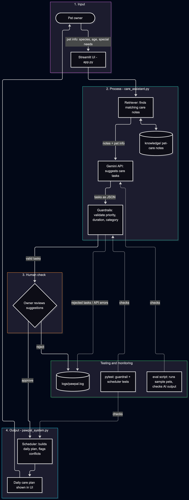
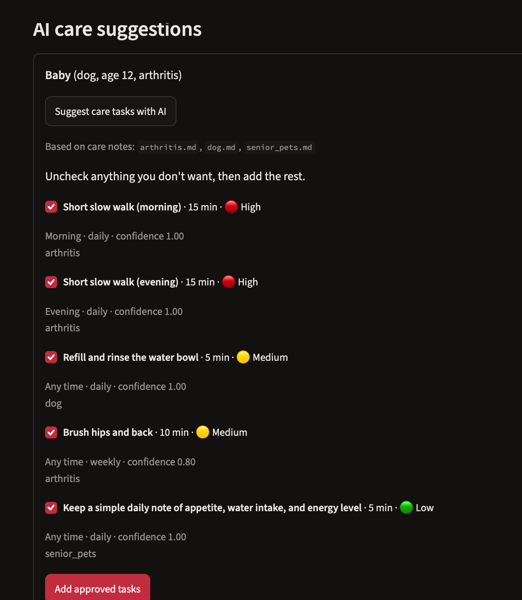
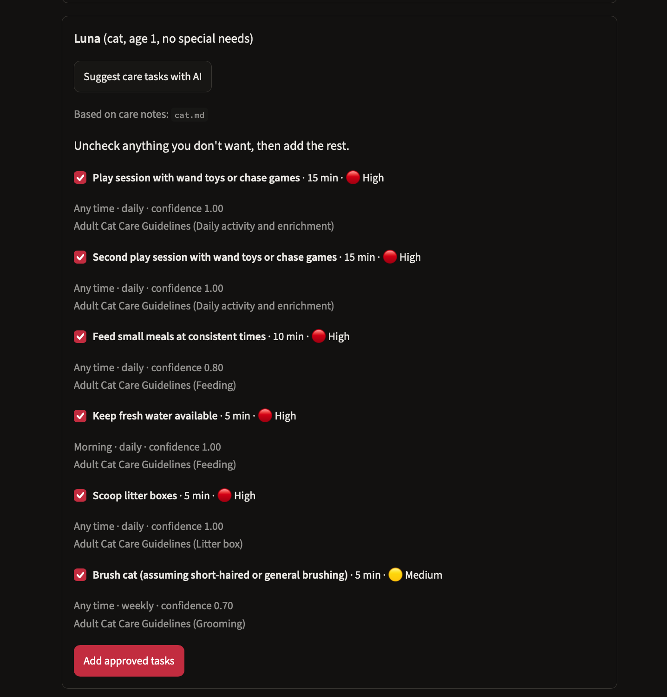
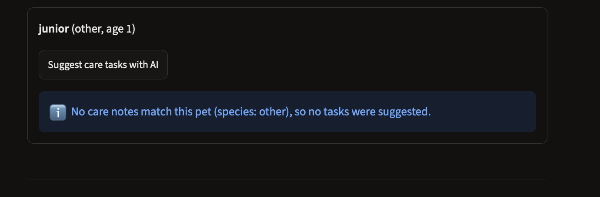
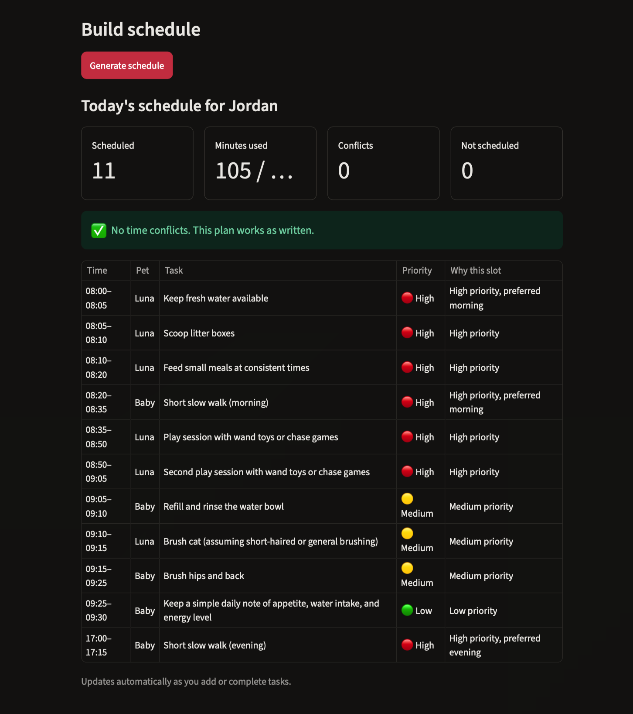

# 🐾 PawPal+ AI: Pet Care Planner with a Retrieval-Augmented Care Assistant

PawPal+ AI helps busy pet owners turn "what does my pet actually need?" into a realistic daily schedule. When you add a pet, an AI care assistant looks up relevant care guidelines for that pet's species, age, and special needs, suggests care tasks grounded in those guidelines, and, once you approve them, schedules them around the time you actually have.

**Why it matters:** generic AI chatbots give generic pet advice. This system grounds every suggestion in a curated knowledge base, checks each suggestion before it touches your schedule, and keeps a human in control of what gets added.

---

## 📌 Original Project (Modules 1–3)

This project extends **PawPal+**, my Module 2 project for CodePath AI110. The original PawPal+ was a Streamlit app where a pet owner could enter pets and care tasks (walks, feeding, meds, grooming) and get a daily plan built around their available time and task priorities. Its scheduler handled fixed and flexible time slots, daily/weekly recurring tasks, overlapping-task conflict detection with fix suggestions, and a plain-language explanation for every scheduled or skipped task. There was no AI in it: the owner had to know and enter every task by hand.

---

## 🏗️ Architecture Overview



Diagram source: [`diagrams/architecture.mmd`](diagrams/architecture.mmd)

The system runs in four stages:

1. **Input:** the owner adds a pet (species, age, special needs) in the Streamlit UI (`app.py`).
2. **Process (RAG):** `care_assistant.py` runs the AI pipeline.
   - The **retriever** selects the matching care notes from the `knowledge/` folder (for example, `dog.md` + `senior_pets.md` for a 12-year-old dog).
   - The retrieved notes and the pet's details are sent to the **Gemini API**, which is instructed to suggest tasks *only* based on those notes and return them as JSON.
   - **Guardrails** validate every suggestion (allowed priority, duration between 1 and 240 minutes, known category, required fields). Invalid suggestions and API errors are logged and never reach the schedule.
3. **Human check:** the owner reviews the suggested tasks and approves or rejects each one.
4. **Output:** approved tasks become real `Task` objects in the existing scheduler (`pawpal_system.py`), which builds the daily plan, flags conflicts, and explains its choices.

**Testing and monitoring:** `pytest` covers the scheduler and the guardrails; an evaluation script runs sample pets through the full pipeline and checks the AI's output; everything the assistant retrieves, suggests, accepts, or rejects is written to `logs/pawpal.log`.

---

## ⚙️ Setup Instructions

**Requirements:** Python 3.10+ and a free Gemini API key (from aistudio.google.com).

```bash
# 1. Clone the repo
git clone https://github.com/gouriddhi/codepath-applied-ai-system-project.git
cd codepath-applied-ai-system-project

# 2. Create and activate a virtual environment
python -m venv .venv
source .venv/bin/activate        # Windows: .venv\Scripts\activate

# 3. Install dependencies
pip install -r requirements.txt

# 4. Add your API key
cp .env.example .env
# then open .env and set GEMINI_API_KEY=your-key-here

# 5. Run the app
streamlit run app.py
```

**Run the tests** (no API key needed; the AI calls are mocked):
```bash
pytest
```

**Run the AI evaluation** (uses the API):
```bash
python eval_assistant.py
```

---

## 💬 Sample Interactions

**Example 1: Senior dog with arthritis**
- Input: `Baby, dog, age 12, special needs: arthritis`
- Retrieved notes: `arthritis.md`, `dog.md`, `senior_pets.md`
- AI output (all passed guardrails, owner approved): short slow walks (morning, evening) at 15 min, refill water bowl, brush hips and back (weekly, confidence 0.80), daily note of appetite/water/energy (low priority)
- Result: tasks added to the schedule and planned with no conflicts



**Example 2: Young cat, no special needs**
- Input: `Luna, cat, age 1, no special needs`
- Retrieved notes: `cat.md` only
- AI output: two play sessions, feeding (confidence 0.80), fresh water, litter scooping, weekly brushing (confidence 0.70, the AI noted it was assuming coat type)



**Example 3: Guardrail: unknown species**
- Input: `junior, species: other, age 1`
- Result: "No care notes match this pet (species: other), so no tasks were suggested." No API call was made and no tasks were invented.



**End-to-end: AI tasks in the real schedule**
After approving suggestions for both pets, the existing scheduler planned all 11 AI-suggested tasks (105 minutes) with 0 conflicts and 0 skipped, each with a reason for its time slot.



---

## 🧠 Design Decisions

- **Simple, transparent retrieval over vector embeddings.** The knowledge base is a small set of hand-written markdown notes, so the retriever matches on species, age group, and special-needs keywords. This is easy to test, needs no extra infrastructure, and makes it obvious *why* a note was retrieved. Trade-off: it won't find notes that use different wording than the pet's details, and it won't scale to a large knowledge base the way embeddings would. Keyword matching also produced a real bug: an owner typing "no special needs" matched `arthritis.md`'s `special-needs` tag on the word "special". The fix was to ignore filler words ("no", "none", "special", "needs") when matching, plus a regression test. A similar over-match (every senior pet getting arthritis advice because the note was tagged `senior`) was fixed by removing that tag, so arthritis guidance now only comes from a stated need.
- **A free-tier Flash-Lite model.** The assistant uses `gemini-3.5-flash-lite` (set once as `MODEL_NAME` in `care_assistant.py`). The task is short, structured JSON based on a few notes, so a small, fast, free model is enough. I first used `gemini-2.5-flash`, but it returned a 404 for new API users; the error handling showed a friendly warning instead of crashing, and the log made the cause clear. Keeping the model name in one constant made the switch a one-line change.
- **No API call when no notes match.** If the retriever finds nothing (e.g. a rabbit or an empty species), the assistant returns "No care notes match this pet" without calling Gemini at all. That makes it impossible for the model to invent advice with nothing to ground it, and it saves free-tier quota. Trade-off: unsupported species get no suggestions, not even generic ones.
- **Relabel duplicate titles instead of dropping them.** Gemini sometimes suggests the same task several times (e.g. "Short slow walk" three times for a senior dog), which is often intended, because the notes recommend two or three short walks a day. Rather than deleting repeats, the guardrails keep them all and make the titles distinct: by time of day when they differ ("Short slow walk (morning)") or numbered otherwise ("Feeding 1/2"). The owner can still uncheck any they don't want.
- **The AI suggests; the scheduler decides.** Gemini only proposes tasks. The existing, already-tested `Scheduler` still decides when things happen. This keeps the AI's job small and checkable, and reuses code that was already tested. Trade-off: the AI can't directly optimize the schedule itself.
- **Structured JSON output + validation.** Asking for JSON with fixed fields means every suggestion can be checked against the same rules as a hand-entered task. Anything that fails validation is dropped and logged rather than "fixed" silently.
- **Human approval before anything is scheduled.** Pet care involves medication and health, so the owner always reviews AI suggestions instead of having them added automatically. Trade-off: one extra click for the user.
- **Grounded prompts.** The prompt tells the model to base suggestions only on the retrieved notes and to say so when the notes don't cover a situation, which reduces made-up advice.

---

## 🧪 Testing Summary

**Automated tests:** `pytest` runs 68 tests and all pass (48 original scheduler tests + 20 care-assistant tests). The AI tests use a fake Gemini client, so they need no API key. They cover retrieval, guardrails (duration 0 and 600, priority "urgent", unknown category, missing title, confidence 1.5), duplicate titles, malformed JSON, 429 rate limits, and a missing API key.

**Evaluation script** (`python eval_assistant.py`, real Gemini calls):

| Pet | Retrieved notes | Accepted | Rejected | Avg confidence | Result |
|---|---|---|---|---|---|
| Senior dog with arthritis | arthritis, dog, senior_pets | 8 | 0 | 0.96 | Pass |
| Young cat, no needs | puppies_kittens | 4 | 0 | 0.95 | Pass |
| Puppy | puppies_kittens | 5 | 0 | 0.84 | Pass |
| Senior cat on medication | cat, medications, senior_pets | 7 | 0 | 0.86 | Pass |
| Rabbit (no notes) | (none) | 0 | 0 | - | Pass |
| Empty species | (none) | 0 | 0 | - | Pass |

**6/6 passed, average confidence 0.90 across 24 accepted tasks.**

**What testing caught (and how it was fixed):**
- **Model retired:** `gemini-2.5-flash` returned a 404 for new users. The error handling caught it and the log showed the cause, so I switched to `gemini-3.5-flash-lite`.
- **Duplicate titles:** the AI returned "Short slow walk" 3 times. I added a guardrail that labels repeats by time of day or number.
- **Retrieval bug:** a 1-year-old cat retrieved `arthritis.md` because its special needs were typed as "no special needs", and the word "special" matched the note's `special-needs` tag. Filler words like "no", "none", "special" and "needs" no longer count as matches. Fixed, with a regression test.
- **Over-retrieval:** every senior pet got arthritis advice because the note was tagged `senior`. I removed the tag so arthritis guidance only comes from a stated need, and added a test.
- **Uninformative confidence:** every score was 1.00 at first. After I rewrote the prompt with examples, inferred tasks scored 0.70–0.80.

**Limits of this testing:** the eval checks that the pipeline produces valid tasks, not that the advice is correct; correctness was checked by my own review of the outputs. Gemini never produced an invalid task in real runs, so the guardrail rejections are proven only by unit tests with deliberately bad input.

For the system's limitations and biases, possible misuse, and how I collaborated with AI on this project, see the [model card](model_card.md).
